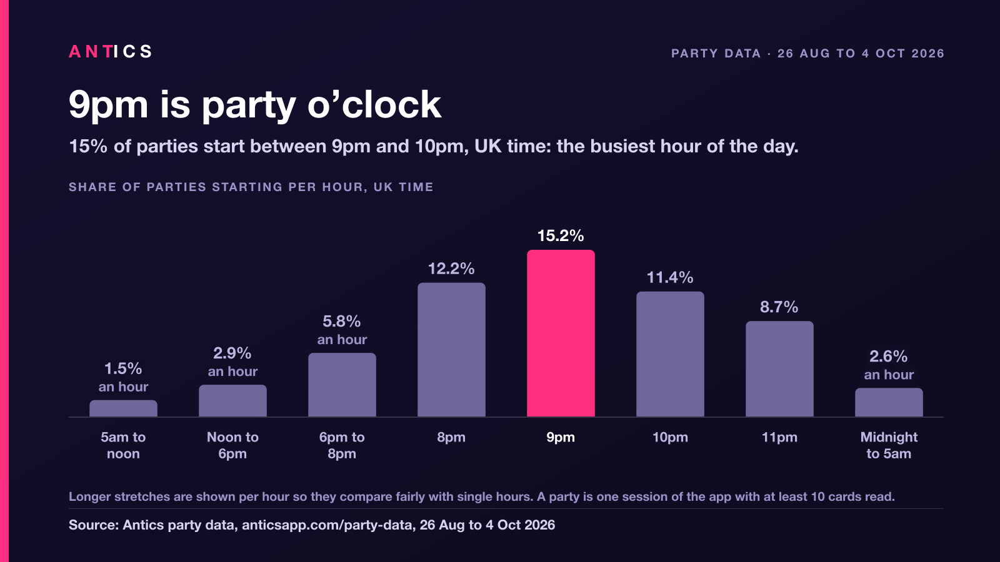
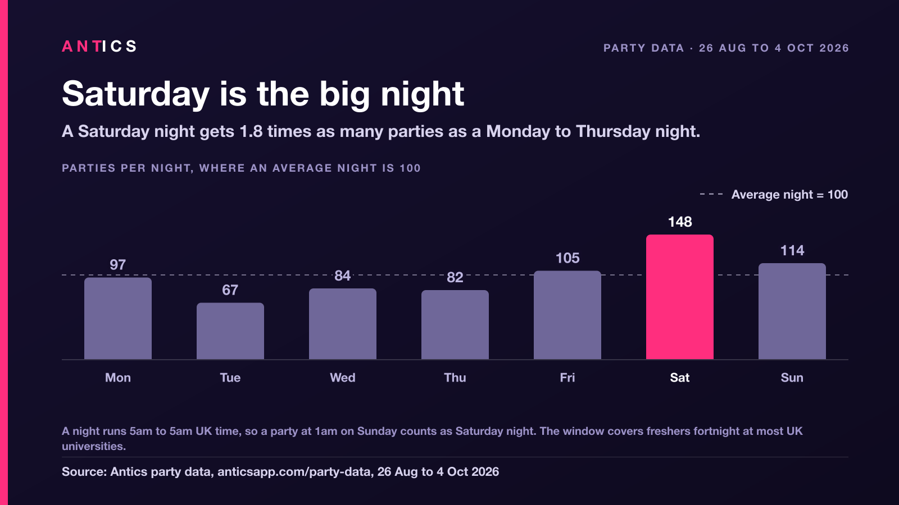
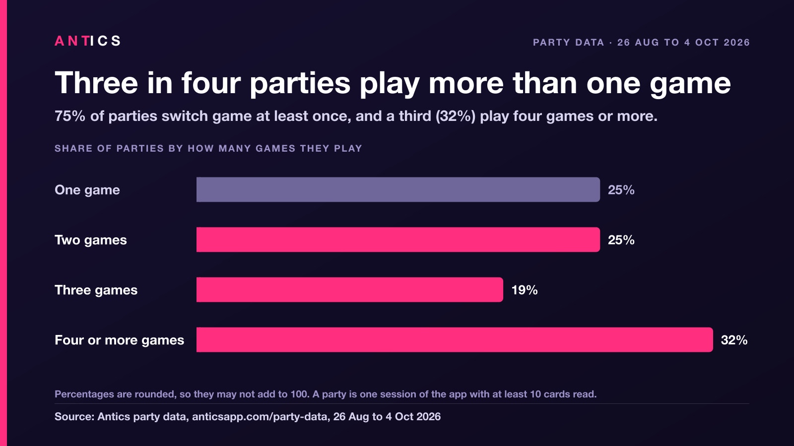
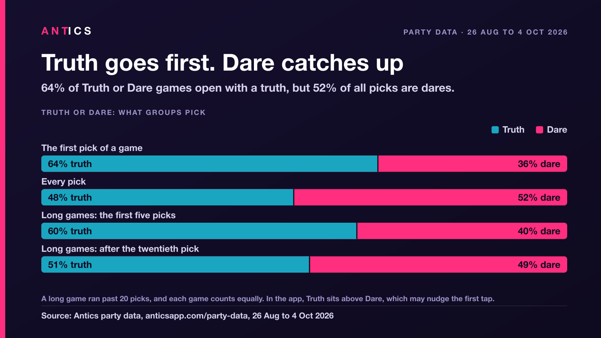
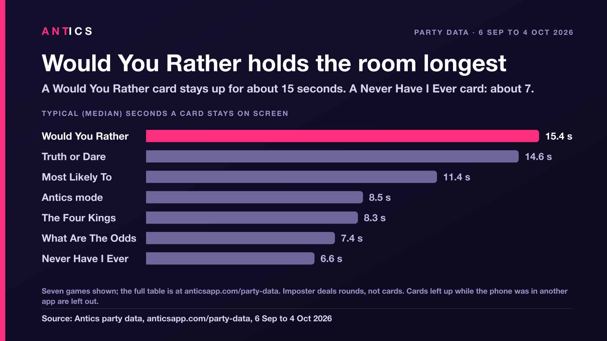

# Antics party data: how groups play party games

Anonymous shares, ratios and medians from parties played on Antics, a pass-the-phone party game app, between 26 August and 4 October 2026. They show when groups start a party (UK time), which night of the week is busiest, how many games a party plays, whether groups pick truth or dare, and which cards get skipped.

**Canonical source: [anticsapp.com/party-data](https://anticsapp.com/party-data/).** This repository holds the same figures and charts as that page, in one place, for anyone who wants the files. If you use them, please link to the page.

## Headline findings

- **9pm is party o'clock.** 9pm to 10pm, UK time, is the busiest hour to start a party: 15.2% of all parties start in that one hour.
- **Most parties start in the evening.** Three in five (59%) start between 6pm and midnight, and more start between 9pm and midnight (35%) than in the whole stretch from 5am to 6pm (28%).
- **Saturday is the big night.** A Saturday night gets 1.8 times as many parties as a Monday to Thursday night. Sunday (114) and Friday (105) come next, where an average night is 100.
- **Three in four parties play more than one game.** 75% of parties switch game at least once, and a third (32%) play four or more. In parties with the full decks unlocked, two in three (67%) still switch.
- **Never Have I Ever and Antics mode turn up most.** Each is played in almost half of all parties (46% and 45%). Antics mode is the most common first game (27% of parties), and the most common switch is from Antics mode straight into Never Have I Ever (11% of parties).
- **Truth goes first. Dare catches up.** 64% of Truth or Dare games open with a truth, but 52% of all picks are dares. In games that run past 20 picks, the share of dares climbs from 40% in the first five picks to 49% after the twentieth.
- **One in seven Never Have I Ever cards gets skipped.** 14.9% are flicked past in under two seconds, nearly three times the rate for Truth or Dare (5.3%). Only Spicy, the app's 18+ deck, is skipped more often (16.5%).
- **Would You Rather and Truth or Dare hold the room longest.** A card stays on screen for a median of 15.4 seconds (Would You Rather) and 14.6 seconds (Truth or Dare): more than twice as long as a Never Have I Ever card (6.6 seconds).

## Charts

Each chart is a 1600 x 900 PNG with the source set into the image. Portrait versions for social posts are on the [canonical page](https://anticsapp.com/party-data/#charts).

*9pm is party o'clock: 15.2% of parties start between 9pm and 10pm, UK time. Longer stretches are shown per hour.*

*Saturday is the big night: 148 against an average night of 100, and 1.8 times a Monday to Thursday night.*

*Three in four parties play more than one game, and 32% play four or more.*

*Truth goes first, dare catches up: 64% of games open with a truth, and 52% of all picks are dares.*

*Would You Rather and Truth or Dare hold the room longest: median seconds a card stays on screen, 6 September to 4 October 2026. Seven games are shown; Spicy (8.0 seconds) is in the CSV.*

## Files

| File | What it is |
| --- | --- |
| [`data/antics-party-data-2026-10.csv`](data/antics-party-data-2026-10.csv) | Every figure on the canonical page, one row per figure, UTF-8, comma separated, with a header row. An exact copy of the CSV on [anticsapp.com/party-data](https://anticsapp.com/party-data/). |
| [`charts/party-start-time.png`](charts/party-start-time.png) | When parties start, per hour, UK time. |
| [`charts/party-night-of-week.png`](charts/party-night-of-week.png) | Parties per night of the week, where an average night is 100. |
| [`charts/party-games-per-party.png`](charts/party-games-per-party.png) | How many games a party plays. |
| [`charts/party-truth-or-dare.png`](charts/party-truth-or-dare.png) | Truth against dare, first pick, every pick and long games. |
| [`charts/party-card-time.png`](charts/party-card-time.png) | Median seconds a card stays on screen, by game. |
| [`datapackage.json`](datapackage.json) | A [Frictionless Data Package](https://specs.frictionlessdata.io/data-package/) describing the CSV and its columns, for tools that read one. |
| [`CITATION.cff`](CITATION.cff) | Citation metadata. GitHub reads it to show a "Cite this repository" button. |
| [`LICENSE`](LICENSE) | The licence: CC BY 4.0. |

## Columns

The CSV has six columns. Every value is a share, an index, a ratio or a median. There are no counts.

| Column | Meaning |
| --- | --- |
| `section` | Which finding the row belongs to. The values are listed below. |
| `measure` | What the row measures, in plain words: a part of the day, a night of the week, a game, or a named comparison such as "first pick is truth". |
| `value` | The number. Rounded as published: one decimal place for start times, the Saturday ratio, skips and seconds on screen; whole numbers everywhere else. |
| `unit` | What `value` is measured in. The values are `% of parties per hour`, `index (average night = 100)`, `times as many parties`, `% of parties`, `% of those parties`, `% of games`, `% of picks`, `% (mean per game)`, `% of cards skipped` and `median seconds`. |
| `window` | The UK days the row covers, first and last day included, written as `YYYY-MM-DD to YYYY-MM-DD`. Every row covers 26 August to 4 October 2026, except `time_on_screen`, which starts on 6 September 2026. |
| `definition` | The counting rule behind that row, in a few words. |

### Values of `section`

| `section` | What it holds |
| --- | --- |
| `start_time` | The share of parties that start in each part of the day, UK time, given per hour. Longer stretches are divided by their number of hours so they compare fairly with single hours; the `definition` column gives each stretch's length (for example "7 hour block"). Multiply by that length to get the whole stretch's share. |
| `night` | Parties per night of the week as an index, where an average night is 100. A night runs from 5am to 5am UK time. One extra row gives the ratio of parties on a Saturday night to parties on a Monday to Thursday night. |
| `games_per_party` | The share of parties that played one, two, three, or four or more different games. |
| `games_played` | The share of parties that played at least one card from each game. A party can play several games, so these add up to more than 100. |
| `games` | Three single facts about which game comes first and how groups switch: the share of parties with the full decks unlocked that switch game, the share of parties whose first game is Antics mode, and the share of parties with at least one direct switch from Antics mode to Never Have I Ever. |
| `truth_or_dare` | What groups pick in Truth or Dare: the first pick of a game, every pick, and the share of dares early and late in long games (more than 20 picks). |
| `skips` | The share of each game's cards that are skipped: on screen for under two seconds. |
| `time_on_screen` | The median number of seconds a card stays on screen, by game. |

Percentages are rounded, so a set of shares may not add up to exactly 100.

## How it was counted

- **Source.** Antics' own anonymous in-app analytics, from the App Store and Google Play versions of the app only. Phones on TestFlight, Google Play internal testing or a development build, and anything played in a web browser, are left out. Each event is counted once, even if a phone sent it twice. The app never records names, typed text or anyone's answers.
- **Window.** 26 August to 4 October 2026, UK days, read on 5 October 2026. Each event is placed in the window by the time on the phone that recorded it. Seconds on screen start on 6 September 2026, when the app started measuring them exactly.
- **The UK clock.** Every time is UK clock time (British Summer Time throughout this window). The data carries no time zone for the group, so a group abroad shows up at the UK hour: an evening in New York lands after midnight here.
- **A party.** One session of the app with at least 10 cards read. A card counts as read if it stays on screen for two seconds or more. If a group closes the app and opens it again, that counts as two parties.
- **When a party starts.** At its first card that wasn't skipped.
- **A night.** 5am to 5am UK time, so a party that starts at 1am on Sunday belongs to Saturday night. The night rows cover the nights from Wednesday 26 August to Saturday 3 October 2026; the last one ends at 5am on 4 October.
- **Games in a party.** Every game with at least one card in the party. The first game is the game of the party's first card. "Full decks unlocked" means a party dealt mostly from unlocked decks.
- **Truth or Dare.** A game is one session of the app that played Truth or Dare, of any length, and every pick is a tap on the Truth or the Dare button. A long game ran past 20 picks. For long games each game counts equally (the dare share is worked out per game, then averaged), so one marathon game can't outvote the rest.
- **A skip.** A card on screen for under two seconds: too quick to read out. A run of five or more quick flicks in a row counts as scrolling, not skipping, and is left out of both skips and seconds on screen.
- **Seconds on screen.** The median for each game. Any card that was still up when the phone switched to another app is left out.
- **Cards, not parties.** Skips, seconds on screen and Truth or Dare picks come from every session in the window, not only from parties, with the exclusions above.
- **Imposter.** Imposter deals whole rounds, not cards, so it isn't in the skips or seconds on screen.
- **Small numbers.** Every figure clears a minimum sample size, and anything thinner was cut.

## What it can't tell you

- **Who is in the room.** Not how many people (adding names is optional), not anyone's age, and not which language a group plays in. The app records only taps on its language setting, and there were too few to say anything.
- **Everyone.** These are Antics groups, not everyone. Only groups who opened Antics are in it, and the app is rated 18+. Most play in the UK and Ireland.
- **The right hour for groups abroad.** Times are UK clock time, so a group in another time zone lands at the wrong hour.
- **A normal month.** The window covers freshers fortnight at most UK universities, which lifted every night of the week in mid September.
- **Choices untouched by the app's layout.** Antics mode is the first tile on the app's home screen, which helps it get picked first. In Truth or Dare, the Truth button sits above Dare, which may nudge the first tap.
- **Whole nights.** A party is one session of the app, so a group that closes the app and opens it again counts as two parties.
- **Which game is better.** Seconds on screen partly reflect the format: a Never Have I Ever card is a single line, a Would You Rather card starts an argument.

## Licence and credit

The data and charts are free to use under [Creative Commons Attribution 4.0 International (CC BY 4.0)](https://creativecommons.org/licenses/by/4.0/). Journalists, student media, researchers and bloggers are all welcome to use them.

Please credit Antics and **link to [https://anticsapp.com/party-data/](https://anticsapp.com/party-data/)**, the canonical source. The suggested credit line:

> Source: [Antics party data](https://anticsapp.com/party-data/), 26 August to 4 October 2026.

Where a link can't be clickable (print, a chart, a slide), write the address out: `Source: Antics party data, anticsapp.com/party-data, 26 August to 4 October 2026.` The charts already carry a source line inside the image.

## How to cite

> Antics App Ltd (2026). *Antics party data: how groups play party games, 26 August to 4 October 2026* [Data set]. https://anticsapp.com/party-data/. Files: https://github.com/GMAntics/party-data

GitHub's "Cite this repository" button offers APA and BibTeX versions, generated from [`CITATION.cff`](CITATION.cff).

## About the source

Antics is a pass-the-phone party game app for iPhone and Android, with nine games played on one phone passed round the room. It is made by Antics App Ltd, a company in London founded by Guy Matthews. More at [anticsapp.com](https://anticsapp.com/).

## Contact

For press, a different cut of the data or a quote, email [support@anticsapp.com](mailto:support@anticsapp.com).
